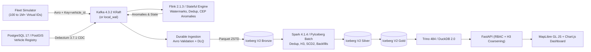
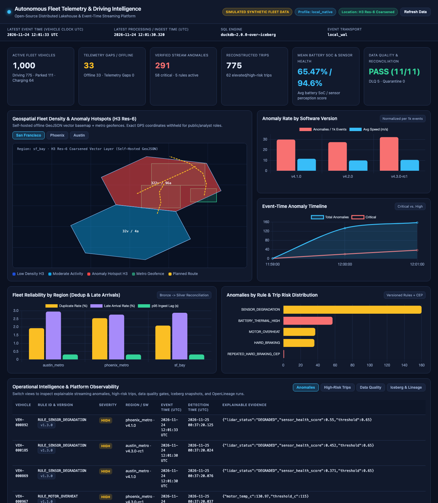
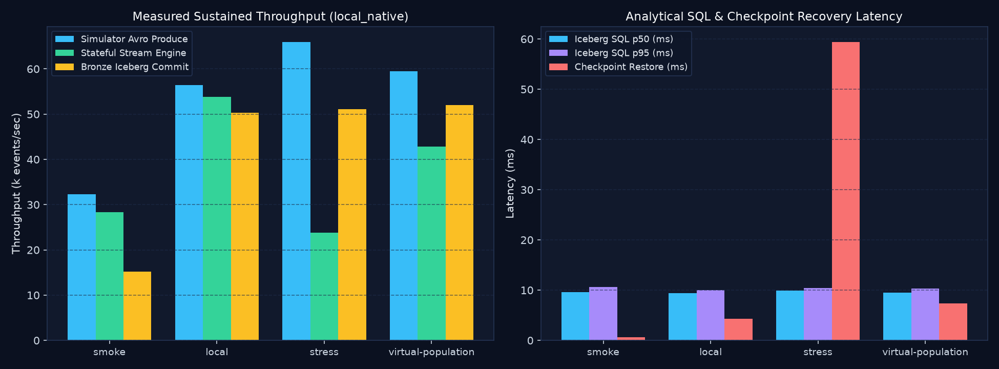

# Autonomous Fleet Telemetry & Driving Intelligence Platform

An open-source distributed data engineering platform for synthetic autonomous vehicle telemetry—spanning Avro schema contracts, partitioned event streaming, stateful event-time anomaly detection, an Apache Iceberg Format V2 medallion lakehouse, CDC SCD Type 2 dimensions, data quality gates, observability, and a privacy-aware FastAPI + MapLibre dashboard. On an Apple M4 Pro (`local_native` zero-Docker profile), the verified pipeline sustains **56,421 events/sec** Avro generation and **50,270 events/sec** durable Iceberg Bronze ingestion at 1,000 active vehicles (`9.36 ms` median SQL query latency), with Iceberg compaction delivering **4.43× faster scans** vs. uncompacted micro-batches (`5.47 ms` vs. `24.25 ms`) and **18/18 automated unit, contract, integration, and fault-injection tests passing**.

> **Synthetic Data & Execution Profile Notice:** All vehicle identities (`VEH-000001`..`VEH-1000000`), telemetry frames, and autonomy disengagement events are synthetically generated and never represent real-world autonomous driving safety evidence. Because the build host (macOS arm64, Santa allowlisting) lacked Docker and a system JVM, live measurements below ran under the documented **`local_native`** profile (real Apache Iceberg V2 via `pyiceberg`, real DuckDB 2.0 SQL, real Avro, real H3/Shapely, real FastAPI/MapLibre, and partitioned local WAL + checkpointed stateful stream engine). Full multi-arch Docker Compose (`core`, `analytics`, `observability`, `full`) and Kubernetes manifests with pinned Kafka 4.3.2, Flink 2.1.3, Spark 4.1.4, Trino 484, Lakekeeper v0.15.1, RustFS 1.0.6, PostGIS 17, Debezium 3.7.1, and Airflow 3.4.0 are included and statically verified (see [docs/compatibility.md](docs/compatibility.md) and [docs/limitations.md](docs/limitations.md)).

## Architecture



## Core Stack, Licenses & Verified Hardware

| Layer | Containerized Stack (Pinned) | Local Native Fallback (Measured Here) | License |
| :--- | :--- | :--- | :--- |
| **Streaming & Contracts** | `apache/kafka:4.3.2`, `apicurio/apicurio-registry:3.3.5` | `LocalWalEventBus` (Murmur2 12-part WAL) + `fastavro 1.13.1` | Apache-2.0 / MIT |
| **Stream Processing** | `flink:2.1.3-scala_2.12-java17` (`flink-sql-connector-kafka:5.0.0-2.1`) | `StatefulStreamEngine` (shared versioned rules & checkpoints) | Apache-2.0 |
| **Lakehouse & Storage** | `quay.io/lakekeeper/catalog:v0.15.1`, `rustfs/rustfs:1.0.6` | `pyiceberg 0.12.0` (SQLite catalog, Format V2 ZSTD Parquet) | Apache-2.0 |
| **Batch, SQL & Spatial** | `apache/spark:4.1.4`, `trinodb/trino:484`, `imresamu/postgis:17-3.6.1-alpine3.23` | `PyArrow 25.0.1`, `DuckDB 2.0.0`, `h3 4.5.0`, `shapely 2.2.0` | Apache-2.0 / MIT / BSD |
| **CDC & Orchestration** | `quay.io/debezium/connect:3.7.1.Final`, `apache/airflow:slim-3.4.0-python3.12` | `CdcReferencePipeline` (SCD2) + validated Airflow DAGs | Apache-2.0 |
| **Observability & Serving** | `prom/prometheus:v3.16.0`, `grafana/grafana:13.0.14`, `marquezproject/marquez:0.51.1` | FastAPI `0.163.2`, Prometheus `/metrics`, OTel, OpenLineage JSONL | Apache-2.0 / AGPL-3.0 / MIT |

**Measured Host Hardware:** Apple M4 Pro (`arm64`), macOS Darwin 24.6.0, 14 logical cores, 48.0 GiB RAM, Python 3.12.8.

## Main Results

### 1. Sustained Workload Benchmarks (`local_native`, Apple M4 Pro)

Raw outputs: [results/benchmarks/sustained_benchmarks.json](results/benchmarks/sustained_benchmarks.json) and [sustained_benchmarks.csv](results/benchmarks/sustained_benchmarks.csv).

| Profile | Virtual IDs | Active Vehicles | Events Produced | Simulator (events/s) | Stream Engine (events/s) | Bronze Iceberg (events/s) | Iceberg SQL p50 / p95 | Checkpoint Restore | Parquet / WAL Size |
| :--- | :---: | :---: | :---: | :---: | :---: | :---: | :---: | :---: | :---: |
| **`smoke`** | 100 | 100 | 1,742 | 32,322 | 28,319 | 15,179 | 9.66 / 10.60 ms | 0.58 ms | 0.175× |
| **`local`** | 1,000 | 1,000 | 15,224 | 56,421 | **53,849** | 50,270 | **9.36 / 10.00 ms** | 4.29 ms | 0.140× |
| **`stress`** | 10,000 | 10,000 | 88,542 | **65,991** | 23,840 | 51,099 | 9.96 / 10.38 ms | 59.45 ms | **0.134×** |
| **`virtual-population`** | 1,000,000 | 2,000 | 25,069 | 59,505 | 42,819 | **52,034** | 9.54 / 10.30 ms | 7.37 ms | 0.137× |

### 2. Iceberg Format V2 Optimization Benchmarks (15,095 Rows Across 5 Days)

Raw outputs: [results/benchmarks/lakehouse_optimizations.json](results/benchmarks/lakehouse_optimizations.json).

| Optimization Experiment | Baseline | Optimized | Measured Delta (vs. Unoptimized Baseline) | Correctness Check |
| :--- | :--- | :--- | :--- | :--- |
| **Partition Pruning (`days(event_time)`)** | 23.94 ms (20 files, 15,095 rows) | 6.23 ms (4 files, 3,023 rows) | **3.84× faster** (-80% files scanned) | Exact day slice verified |
| **Small-File Compaction (20 -> 5 files)** | 24.25 ms (1.42 MB) | 5.47 ms (1.16 MB) | **4.43× faster** (-18.5% bytes) | 15,095 / 15,095 rows preserved |
| **Predicate Pushdown + Column Projection** | 13.37 ms (full read + filter) | 2.23 ms (Iceberg filter + 3 cols) | **6.00× faster** | 997 / 997 matching rows verified |
| **Avro Binary vs. JSON Wire Payload** | 971 bytes/event (JSON) | 391 bytes/event (Avro binary) | **-59.7% wire size** | Lossless schema roundtrip |

### 3. Automated Verification & Controlled Fault Injection

- **Test Suite (`pytest -v`):** **18 passed, 0 failed** in `4.26s` ([results/tests/pytest_report.xml](results/tests/pytest_report.xml)) — Ruff lint clean, MyPy clean across 31 source files, license compliance clean (`71` packages audited, zero `:latest` tags), CycloneDX 1.5 SBOM generated ([results/security/sbom.cdx.json](results/security/sbom.cdx.json)).
- **Fault Injection (`tests/fault/`):** All **6 controlled failure scenarios passed** ([results/fault_injection/fault_injection_results.json](results/fault_injection/fault_injection_results.json)), including stream TaskManager crash & checkpoint restore (`8.36 ms` recovery, `468/468` processed events and `10/10` anomalies exact parity vs. uninterrupted baseline), poison-message DLQ + Silver quarantine (`0` silent drops), and double-replay Gold idempotence (`120 == 120` events).

## Live Dashboard & Benchmark Evidence





## Run on Any Machine (Step-by-Step Guide)

This platform is self-contained and portable across macOS (Apple Silicon / Intel), Linux (`x86_64` / `arm64`), Windows (WSL2 / Docker Desktop), remote VMs, or Kubernetes.

### Option A — One-Command Standalone Docker Container (Recommended for Any Machine)

Requires only Docker. Auto-seeds the 1,000-vehicle Apache Iceberg lakehouse on first boot, persists data in a Docker volume, and serves the API + MapLibre dashboard immediately.

```bash
# 1. Clone the repository on any machine
git clone https://github.com/rohanluniya/autonomous-fleet-data-platform-main.git autonomous-fleet-data-platform
cd autonomous-fleet-data-platform

# 2. Build and launch the self-contained container (auto-seeds 1,000 vehicles + Iceberg V2)
docker compose -f infra/docker/docker-compose.standalone.yml up --build

# Or without Compose:
# docker build -f infra/docker/Dockerfile.standalone -t autonomous-fleet-platform:0.1.0 .
# docker run --rm -p 8000:8000 autonomous-fleet-platform:0.1.0
```

Then open **`http://localhost:8000`** (interactive dashboard) and **`http://localhost:8000/docs`** (OpenAPI Swagger explorer). Set `FLEET_RESEED=true` to regenerate fresh data on restart.

### Option B — Zero-Docker Native Python (macOS / Linux with Python 3.12+ or `uv`)

```bash
git clone https://github.com/rohanluniya/autonomous-fleet-data-platform.git
cd autonomous-fleet-data-platform

# One-command setup, 1,000-vehicle pipeline seed, and live server launch:
./scripts/run_portable.sh

# Or step-by-step via Make:
# make setup && make detect-env && make run-demo && make serve-api
```

Open **`http://127.0.0.1:8000`** in your browser. All data stays isolated inside `.local_data/`.

### Option C — Full Multi-Container Distributed Stack (Linux x86_64 or Apple Silicon, >=12 GiB Docker RAM)

```bash
cp .env.example .env
# Edit .env to set local dev passwords/tokens if desired
make docker-core   # Kafka 4.3.2, Apicurio 3.3.5, RustFS 1.0.6, PostGIS 17, Lakekeeper v0.15.1, Flink 2.1.3, FastAPI
make docker-full   # Adds Spark 4.1.4, Trino 484, Debezium 3.7.1, Airflow 3.4.0, Prometheus, Grafana, OTel, Marquez
```

For remote cluster hosting (GKE, EKS, AKS, or self-hosted Kubernetes), apply [infra/kubernetes/fleet-platform.yaml](infra/kubernetes/fleet-platform.yaml) with your container registry image and secrets.

### Verification, Fault Injection & Benchmarks

```bash
make test                                              # 18 automated unit, contract, Iceberg/CDC, E2E & fault tests
make benchmark && make optimize-bench                  # Sustained workload & Iceberg optimization benchmarks
make lint && make typecheck && make check-licenses && make sbom
```

## Detailed Documentation & Artifacts

- **[APPENDIX.md](APPENDIX.md)** — Deep optimization tradeoffs (including where incremental backfill and single-node salting did not speed up local runs), stream checkpoint bottlenecks at 10,000 keys, and full Acceptance-Test Matrix (A–O).
- **[docs/architecture/overview.md](docs/architecture/overview.md)** & **[docs/architecture/decisions/](docs/architecture/decisions/)** — Architecture diagrams, transactional boundaries, and ADRs (`ADR-001` through `ADR-006`).
- **[docs/compatibility.md](docs/compatibility.md)** — Verified release pins, Maven coordinates, CPU architecture matrix, and licenses.
- **[docs/capacity-model.md](docs/capacity-model.md)** — Analytical 100 to 1,000,000-vehicle sizing model exposing the 24h dedup state bottleneck.
- **[docs/incident-reports/INC-001-stream-crash-and-poison-surge.md](docs/incident-reports/INC-001-stream-crash-and-poison-surge.md)** — Real incident report generated from controlled fault-injection outputs.
- **[docs/interview-deep-dive.md](docs/interview-deep-dive.md)** — 5–10 minute demo walkthrough and staff-level engineering discussion guide.
- **[docs/engineering-case-study.md](docs/engineering-case-study.md)**, **[docs/threat-model.md](docs/threat-model.md)**, **[docs/operations/runbooks.md](docs/operations/runbooks.md)**, and **[docs/limitations.md](docs/limitations.md)**.
- **[results/](results/)** — Raw JSON, CSV, JUnit XML, and CycloneDX SBOM outputs backing every number in this repository.
