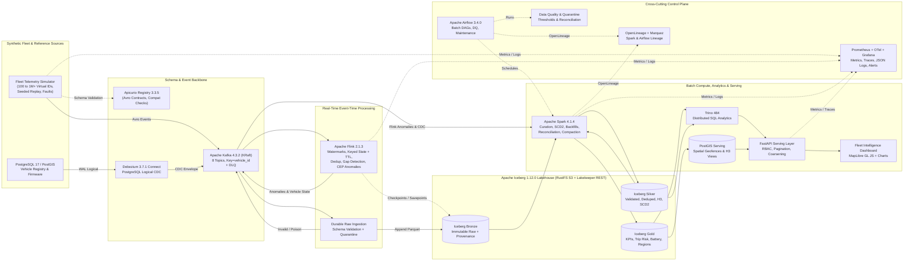

# System Architecture Overview

## 1. Purpose & Design Philosophy

The **Autonomous Fleet Telemetry & Driving Intelligence Platform** is an open-source, distributed data engineering system for ingesting, validating, streaming, curating, and serving high-velocity synthetic autonomous vehicle telemetry.

Three architectural principles govern every design choice:

1. **Strict separation of streaming vs. batch compute:** Apache Flink owns low-latency, stateful event-time processing (watermarks, bounded out-of-order handling, online deduplication, offline/gap detection, and complex event anomaly patterns). Apache Spark owns high-throughput lakehouse curation (Bronze-to-Silver normalization, trip reconstruction, SCD Type 2 vehicle dimensions, Gold KPI aggregation, idempotent backfills, reconciliation, and Iceberg compaction).
2. **Single authoritative lakehouse catalog:** All lakehouse engines (Spark, Flink, Trino, and PyIceberg) interact with one Iceberg REST Catalog (**Lakekeeper**) over S3-compatible object storage (**RustFS**) in Docker/Kubernetes deployments, or an authoritative SQLite Iceberg catalog over local Parquet storage in zero-Docker local execution.
3. **Explicit consistency & failure boundaries:** The platform never claims magical end-to-end exactly-once semantics across heterogeneous systems. Every boundary specifies its exact delivery guarantee, idempotency key, replay contract, and recovery objective.

## 2. Logical Architecture Diagram

## 3. Service Responsibilities & Data Ownership

| Layer | Component | Authoritative Ownership | Primary Interface |
| :--- | :--- | :--- | :--- |
| **Generation** | `services/fleet-simulator` | Synthetic telemetry, kinematic state, controlled fault & anomaly injection with ground truth | Kafka Avro producer (or `local_wal`) |
| **Contracts** | `schemas/` + Apicurio Registry | Avro schemas (`telemetry`, `gps`, `diagnostics`, `trips`, `autonomy`, `anomalies`, `vehicle_state`, `cdc`) | Schema Registry API + CI compat tests |
| **Messaging** | Apache Kafka 4.3.2 (KRaft) | Partitioned durable event log (`key=vehicle_id`), consumer offsets, DLQ quarantine | Kafka binary protocol |
| **Streaming** | `services/stream-processing` (Flink 2.1.3) | Event-time watermarks, online dedup, offline gap detection, CEP anomaly detection | Kafka source/sink, RocksDB checkpoints |
| **Raw Ingestion** | `services/ingestion` | Schema validation, poison-message quarantine to `fleet.telemetry.dlq`, durable Bronze Iceberg append | Kafka consumer -> Iceberg Bronze |
| **Batch Curation** | `pipelines/spark` (Spark 4.1.4) | Bronze->Silver dedup & H3 enrichment, trip reconstruction, SCD2 `dim_vehicle`, Gold KPIs, compaction | Iceberg REST Catalog (`Lakekeeper`) |
| **CDC** | `pipelines/cdc` (PostgreSQL + Debezium) | Operational vehicle registry, region assignment, firmware rollout, maintenance state | Logical replication -> Kafka -> Silver SCD2 |
| **Orchestration** | `pipelines/airflow` (Airflow 3.4.0) | Scheduled incremental lakehouse runs, daily aggregates, backfills, DQ checks, Iceberg maintenance | Airflow DAGs + OpenLineage |
| **Analytical SQL** | Trino 484 (DuckDB 2.0 local fallback) | Ad-hoc & serving SQL queries over Iceberg Silver/Gold tables | Trino HTTP/SQL (DuckDB in local mode) |
| **Serving & UI** | `apps/fleet-api` + `apps/fleet-dashboard` | Authenticated REST API, RBAC raw vs. coarsened spatial views, operational web UI | FastAPI OpenAPI + MapLibre GL JS |

## 4. Transactional Boundaries, Consistency & Sink Semantics

We explicitly reject vague "end-to-end exactly-once" marketing claims. Every hop has a concrete semantic contract:

| Hop | Delivery / Write Semantic | Duplicate / Failure Mechanism | Idempotency & Deduplication Strategy |
| :--- | :--- | :--- | :--- |
| **Simulator -> Kafka** | **At-least-once** (`acks=all`, `enable.idempotence=true`, bounded retries) | Producer crash between broker commit and client ack can resend an event if retried across process restart. | Deterministic `event_id` (UUIDv5 over `seed + vehicle_id + event_type + sequence_number`) enables downstream deduplication. |
| **Kafka -> Flink -> Kafka** | **At-least-once** (default) or **Exactly-once within Flink+Kafka** when transactional Kafka sink (`EXACTLY_ONCE` + `read_committed` consumers) is enabled | TaskManager crash replays from last aligned checkpoint offset; state restored from RocksDB checkpoint. | Online deduplication via keyed `MapState<event_id, first_seen_ts>` with configurable State TTL (default 24h). Events duplicated *after* TTL expiry are caught in Silver batch dedup. |
| **Kafka -> Bronze Iceberg** | **At-least-once append** with batch checkpointing | Ingestion worker crash after Iceberg commit but before Kafka offset commit duplicates a micro-batch in Bronze. | Bronze is intentionally **immutable & append-only** (preserving raw evidence and `replay_batch_id`). Canonical uniqueness is enforced deterministically during Bronze -> Silver `MERGE` / window-dedup on `event_id`. |
| **Bronze -> Silver -> Gold (Spark / Iceberg)** | **Atomic snapshot isolation** per Iceberg table commit (Optimistic Concurrency Control) | Failed batch tasks leave uncommitted Parquet files; retry creates a clean atomic snapshot. Orphan files cleaned only after retention safety window (`>= 72h`). | Silver deduplicates by `(event_id)` keeping earliest `ingest_time` (or highest `cdc_lsn` for CDC). Gold partitions are overwritten atomically via `overwritePartitions` / `MERGE` for parameterized time windows (`execution_date`), making backfills **100% idempotent**. |
| **Gold -> PostGIS / FastAPI** | **Eventually consistent read-after-write** | Serving cache TTL (default 15s) or incremental refresh lag between Gold commit and PostGIS upsert. | PostGIS upserts use `ON CONFLICT (primary_key) DO UPDATE` keyed by natural/surrogate keys; API exposes `data_freshness_seconds` and `event_time` vs `processing_time`. |

## 5. Failure Domains & Recovery Objectives (Local vs. Target Production)

| Failure Domain | Blast Radius | Detection Signal | Target RPO | Target RTO | Verified Recovery Mechanism |
| :--- | :--- | :--- | :--- | :--- | :--- |
| **Single Producer Crash** | Subset of simulated vehicles paused | Producer heartbeat / rate drop alert | 0 committed events | < 10 s | Deterministic seed + sequence resume; Kafka idempotent producer. |
| **Kafka Broker Restart** | Partition leader unavailable during restart | Broker down / under-replicated partitions | 0 (RF=3 prod; single broker local flushes log) | < 30 s | Client backoff/retry; consumer group rebalance; offset resume. |
| **Flink TaskManager Failure** | Streaming latency spike during recovery | Checkpoint duration / restart count alert | 0 processed offsets (checkpointed) | < 45 s | Automatic restart from latest checkpoint/savepoint; replays uncommitted offsets. |
| **Poison / Corrupt Message** | Single event rejected | `fleet_dlq_messages_total` counter alert | 0 silent drops | Immediate | Quarantine to `fleet.telemetry.dlq` with `error_code`, `schema_version`, and raw payload bytes. |
| **Batch Job / Partial Backfill Failure** | Gold partition stale | Airflow task failure + freshness SLA alert | 0 corrupt gold rows | < 5 min | Iceberg atomic commit rolls back partial write; Airflow retries idempotent date-scoped task. |
| **Object Store Outage** | Bronze append & batch jobs paused | S3 5xx / timeout alert | 0 (retained in Kafka during retention window) | Depends on storage | Kafka buffers events (7-day retention target); ingestion resumes from committed consumer offsets once storage recovers. |

## 6. Event-Time Correctness vs. Wall-Clock Processing

- **Event Time (`event_time`):** UTC timestamp recorded on the vehicle when the telemetry sample was generated. All tumbling/sliding/session windows, trip durations, and Gold time buckets use `event_time`.
- **Ingest Time (`ingest_time`):** UTC timestamp assigned at broker/ingestion receipt. Used to measure transport lag (`ingest_time - event_time`) and connectivity-gap buffering delays.
- **Detection / Processing Time (`detection_time`):** Wall-clock UTC timestamp when Flink emits an anomaly or state alert.
- **Late Events Beyond Watermark:** Flink uses bounded out-of-orderness watermarks (default `max_out_of_orderness = 30s`). Events arriving after the watermark passes their window end are **never silently dropped** — they are routed to a dedicated **late-event side output**, persisted to Bronze, and folded into Silver/Gold during the next scheduled incremental batch reconciliation window.
