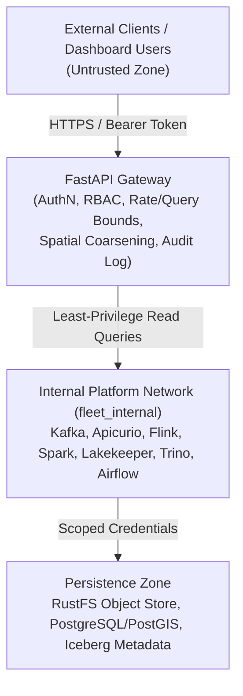

# Security Architecture & Threat Model (STRIDE)

## 1. Security Posture Honesty Statement

This repository ships with **development-ready security controls** (environment-injected secrets, bearer token authentication, RBAC raw-vs-aggregated data enforcement, spatial coarsening, structured audit logs, secret-scanning hooks, and Kubernetes `NetworkPolicy` templates).

**It is NOT drop-in production-hardened out of the box** when run with local Docker Compose or `local_native` defaults:
- Local dev internal Kafka, Lakekeeper, RustFS, and Trino traffic runs over plaintext HTTP/TCP inside an isolated Docker bridge network (`fleet_internal`) unless TLS certificates are mounted.
- Local API authentication uses static bearer tokens loaded from `.env` (`FLEET_API_*_TOKEN`) rather than an external OIDC/JWT identity provider (e.g., Keycloak).
- Production deployment requires mutual TLS (mTLS) across Kafka/Flink/Spark/Trino/Lakekeeper, external secret management (Vault / KMS), OIDC/JWKS token verification, and encrypted-at-rest object storage.

## 2. Trust Boundaries

## 3. STRIDE Threat Analysis & Mitigations

| Threat Category | Specific Attack Vector | Impact | Implemented Control | Production Gap / Next Step |
| :--- | :--- | :--- | :--- | :--- |
| **Spoofing** | Forged API requests or spoofed vehicle telemetry events | Unauthorized access to exact vehicle traces or corrupted anomaly alerts | FastAPI RBAC bearer tokens (`admin`, `operator`, `analyst`, `viewer`); constant-time token comparison (`hmac.compare_digest`); strict Avro schema validation | Replace static tokens with OIDC/JWT (Keycloak); enforce mTLS client certs per vehicle gateway |
| **Tampering** | Poison/malformed payloads or SQL injection through API query parameters | Stream processor crash or unauthorized analytical table reads | Parameterized DuckDB/Trino/SQL queries only; Pydantic query bounds (`limit <= 500`, allowlisted sort columns); poison messages quarantined to `fleet.telemetry.dlq`; Bronze tables append-only | Enable Kafka ACLs + TLS; enable Iceberg catalog RBAC policies in Lakekeeper/OpenFGA |
| **Repudiation** | Unaudited access to raw coordinates or manual replay/backfill runs | Inability to trace who queried fine-grained vehicle locations or triggered data overwrites | Structured JSON audit log events (`audit.api_access`, `audit.raw_location_read`, `audit.replay_triggered`) with actor role, `correlation_id`, and timestamp | Forward audit logs to immutable WORM log sink |
| **Information Disclosure** | Exposure of exact vehicle GPS traces on public dashboards; secrets leaked in logs or Git | Fleet movement tracking, operational security leak, credential compromise | Default spatial coarsening to H3 resolution 6 (`~36 km^2`) for `analyst`/`viewer` roles; exact `lat`/`lon` restricted to `operator`/`admin`; log scrubber strips Authorization headers & tokens; `.env` gitignored; pre-commit private-key check | Enable TLS everywhere, KMS bucket encryption, and field-level masking in Trino |
| **Denial of Service** | Unbounded analytical API queries or telemetry flood from one rogue vehicle | API OOM, Trino saturation, or Kafka single-partition hot-key stall | Mandatory API pagination (`limit <= 500`), query timeouts, short-TTL response cache, per-vehicle simulator rate limiting, bounded Flink state TTL | Add API gateway rate-limiting (Envoy/NGINX), Kafka client quotas (`producer_byte_rate`), K8s `ResourceQuota` & PodDisruptionBudgets |
| **Elevation of Privilege** | Container breakout or lateral movement from dashboard/API to Iceberg admin endpoints | Unauthorized table drops or snapshot deletion | Docker Compose network segmentation (`fleet_edge` vs `fleet_internal`); non-root container users; K8s `NetworkPolicy` manifests restricting ingress to Lakekeeper/Postgres/RustFS; separate read-only API role vs write pipelines | Enable Pod Security Standards (`restricted`), signed images (Cosign), runtime Falco alerts |

## 4. Data Retention, Privacy & Synthetic Identity Policy

- All vehicle identifiers (`VEH-000001`..`VEH-1000000`) and telemetry traces are 100% synthetic. No real PII or real fleet data is included.
- Retention policies are codified in `docs/security/retention-policy.md` and enforced by Iceberg maintenance jobs:
  - Raw Kafka topics: `7–30 days`
  - Iceberg Bronze: `90 days` (snapshot expiration keeps `7 days` / `>= 5` snapshots; orphan cleanup safety window `>= 72 hours`)
  - Iceberg Silver: `365 days`
  - Iceberg Gold aggregates: `730 days`
- Deletion requests for a specific synthetic `vehicle_id` are supported via Iceberg row-level `DELETE` on Bronze/Silver + snapshot expiration (documented in operations runbooks).

## 5. Supply-Chain & License Governance

- All Python dependencies are pinned in `pyproject.toml` and locked in `uv.lock`.
- All container images use explicit version tags (zero `latest`).
- CI workflow (`.github/workflows/ci.yml`) runs license inventory checks, CycloneDX SBOM generation (`scripts/generate_sbom.py`), secret scanning, and dependency vulnerability inspection.
